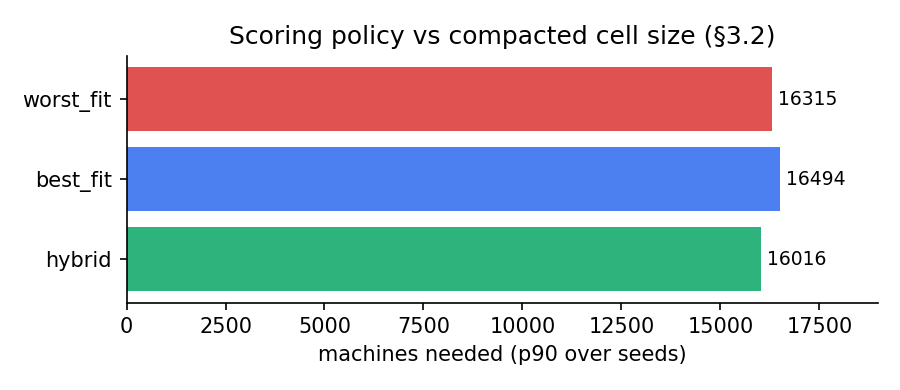
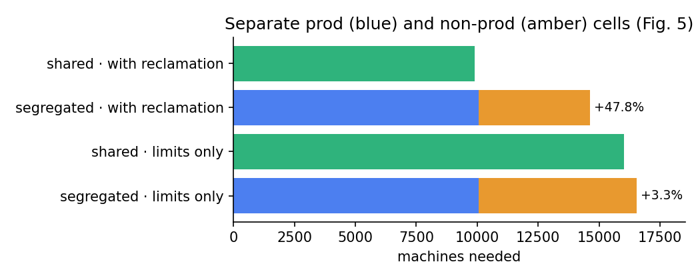
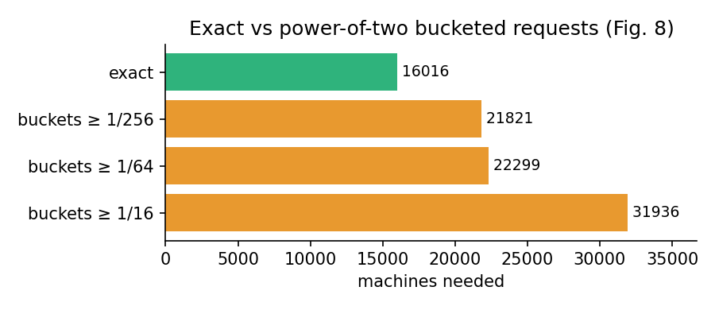
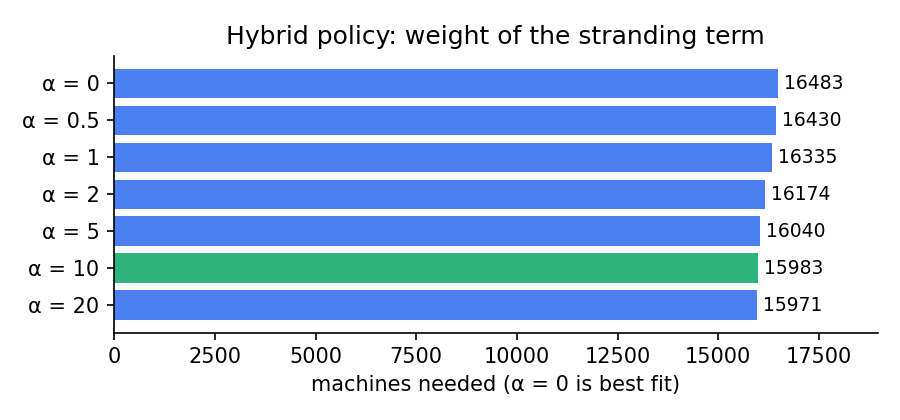
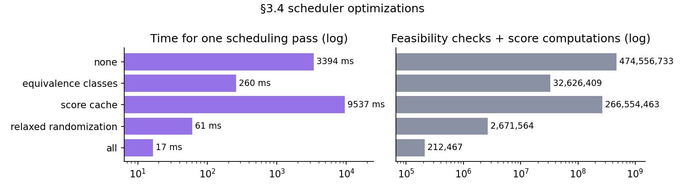

# Google-Borg: replicating the Borg scheduler in C++

A replication of the scheduling module from [*Large-scale cluster management at Google with Borg*](https://research.google/pubs/large-scale-cluster-management-at-google-with-borg/) (Verma et al., EuroSys 2015). It has two parts, built on one shared C++ scheduler library:

- **Plan A, simulation (`borgsim`).** A Fauxmaster-like simulator that packs a snapshot of the public **Google cluster trace (2011)** with our scheduler. It reproduces the paper's experiments using **cell compaction**.
- **Plan B, live mini cell (`borgmaster` + `borglet`).** A real, small Borg cell on Docker:
  - one Borgmaster and five Borglet "machines";
  - tasks isolated with **cgroup v2** (CPU throttling, OOM kills);
  - preemption, failure detection and rescheduling;
  - a **web dashboard** where you submit jobs and watch everything happen live.

See [`docs/plan.md`](docs/plan.md) for the design, decisions and limitations.

```
core/        scheduler library: Cell, Task, Machine, Scheduler (feasibility, scoring, preemption, §3.4 optimizations)
sim/         Plan A: trace loader, synthetic workloads, cell compaction, experiments  -> build/bin/borgsim
master/      Plan B: Borgmaster (REST API, scheduler loop, Borglet poller, serves UI) -> build/bin/borgmaster
borglet/     Plan B: Borglet agent (cgroup v2, task lifecycle, built-in workloads)    -> build/bin/borglet
ui/          dashboard (vanilla HTML/CSS/JS, no build step)
tests/       scheduler unit tests (-> build/bin/test_core) and an end-to-end test of the live cell
tools/       fetch_trace.sh (download trace slice), plot.py (CSV -> PNG)
results/     Plan A output (CSV), also shown in the UI's "Simulation results" tab
```

## Quick start

**Requirements:** a C++17 compiler and `make`. Docker Desktop for Plan B. Python 3 + matplotlib if you want the plots.

```bash
make            # builds borgsim, borgmaster, borglet, test_core
make test       # 14 scheduler unit tests
```

### Plan A: run the experiments

```bash
tools/fetch_trace.sh                          # ~11 MB slice of clusterdata-2011-2 into data/trace
./build/bin/borgsim --workload trace all      # all experiments, 11 seeds each (~15 min)
python3 tools/plot.py                         # optional: results/*.png
```

Without the trace, `./build/bin/borgsim all` uses a synthetic workload (`--machines`, `--fill`). Run `./build/bin/borgsim --help` for the experiment list and options.

### Plan B: start the mini cell and open the UI

```bash
docker compose up --build -d
open http://localhost:8080
```

In the UI:
1. Pick **Batch analytics** and **Free crawler** and submit both to fill the cell.
2. Submit **Big prod job**. It preempts batch tasks, and those cascade onto the free-tier tasks.
3. Click **Fail** on a machine, or run `docker compose stop borglet-3`. After 3 missed polls the machine is marked DOWN and its tasks move elsewhere.
4. **Memory hog** gets OOM-killed by its cgroup. **Crashing service** restarts with exponential backoff.
5. Switch the **scoring policy** at the top right and submit more work to compare placements.
6. Open the **Simulation results** tab to see the Plan A results.

To check the whole cell automatically, run `python3 tests/e2e_cell.py`. It clears the cell's jobs, then checks:
- placement and spreading;
- that preemption takes only lower-priority tasks;
- cgroup OOM kills and `cpu.max` throttling;
- machine failure, rescheduling and recovery.

It takes about 30 s.

Stop everything with `docker compose down`.

To run without Docker (on macOS there's no cgroup isolation, but everything else works):

```bash
./build/bin/borgmaster --port 8080 &
BORGLET_NAME=b1 BORGLET_PORT=9091 BORGLET_ADVERTISE=http://localhost:9091 ./build/bin/borglet &
BORGLET_NAME=b2 BORGLET_PORT=9092 BORGLET_ADVERTISE=http://localhost:9092 ./build/bin/borglet &
```

Borglet settings: `BORGLET_CPU`, `BORGLET_RAM_MB`, `BORGLET_ATTRS=rack=r1,ssd=true`, `BORG_MASTER`, `BORGLET_INSTALL_SECS`.

## How it maps to the paper

| Paper | Here |
|---|---|
| Feasibility checking: constraints + resources, counting lower-priority tasks as available (§3.2) | `Scheduler::feasible` |
| Scoring: E-PVM / worst fit, best fit, hybrid (§3.2) | `Scheduler::score`, `Policy` |
| Preemption from lowest priority up; victims go back to the pending queue (§3.2) | `Scheduler::victims`, `place_with_preemption` |
| Prod tasks don't preempt each other (§2.5) | `Scheduler::protected_from` |
| Priority order with round-robin across users (§3.2) | `Scheduler::order_pending` |
| Score caching, equivalence classes, relaxed randomization (§3.4) | `cached_score`, `schedule`, `find_candidates` |
| Resource reclamation: non-prod fitted against reservations (§5.5) | `SchedulerConfig::reclamation` |
| Cell compaction, 11 seeds, p90, 0.2% picky tasks may pend (§5.1) | `sim/compaction.cpp` |
| Borgmaster polls Borglets; machine down after missed polls; reschedule (§3.3, §3.5) | `master/main.cpp` |
| Borglet starts/kills tasks, enforces limits, SIGTERM then SIGKILL (§2.5, §3.3) | `borglet/main.cpp`, `cgroups.cpp` |
| Package locality: prefer machines that already have the binary (§3.2) | `w_package` score term + Borglet install delay |

## Results (Plan A)


**Workload.** The Google trace 2011, snapshot at the end of a 6-part slice (t = 30,666 s): 12,480 machines and 144,266 running tasks, 55,782 of them prod. CPU requests add up to 116% of capacity and RAM to 99%.

**Method.** Each number is the 90th percentile over 11 seeds of the smallest cell the workload still fits into (cell compaction, §5). The policy is hybrid unless noted. The full log is in [`results/run_trace.log`](results/run_trace.log), and the same results are shown in the UI's *Simulation results* tab.

| Experiment | Our result | Paper |
|---|---|---|
| **Scoring policy** (§3.2) | hybrid **16,016** · worst fit 16,315 · best fit 16,494 machines. Hybrid needs **2.9% fewer machines than best fit** and has the least stranded CPU and RAM | Hybrid is 3–5% better than best fit |
| **Segregating prod / non-prod** (Fig. 5) | **+47.8%** machines with reclamation (9,898 → 14,631); +3.3% with limits only | +20–30% in the median cell |
| **Bucketed requests** (Fig. 8) | **+36%** with buckets ≥ 1/256 of a machine, +39% with ≥ 1/64, +99% with ≥ 1/16 | +30–50% in the median cell |
| **Resource reclamation** (Fig. 10) | **+62%** machines without it (9,898 vs 16,016) | "many more machines"; ~20% of the workload runs in reclaimed resources |
| **§3.4 optimizations** (one pass, 20k tasks, 12,480 machines) | 3,394 ms → **17 ms** with all three (200× faster); feasibility checks 249.6M → 110k | A pass went from over 3 days to a few hundred seconds |
| **Hybrid α** (ablation, 3 seeds) | α = 0 (best fit) 16,483 → α = 10 15,983 machines; gains level off after 10 | (formula not published) |

<p>
 
 

</p>

**What matches.** Every trend is reproduced:
- the stranding-aware hybrid beats best fit, by an amount close to the paper's range;
- a shared cell beats segregated cells, and only once reclamation is on, matching the paper's explanation;
- fine-grained requests beat buckets, with an overhead inside the paper's range;
- reclamation saves many machines;
- equivalence classes and relaxed randomization cut scheduling work by orders of magnitude.

**What differs, and why.**
- **The reclamation and segregation gaps are larger than the paper's.** Reservations come from an assumed usage model (about 51% of CPU limits and 70% of RAM limits), because we don't load the trace's huge `task_usage` table.
- **The score cache alone is *slower* here** (9.5 s). Our score is a few arithmetic operations, so a hash lookup costs more than recomputing it. Borg's scoring is much more expensive.
- **Different data.** The paper used 15 internal cells from 2014; we use one public cell from 2011.
- **Our hybrid formula is our own** (`-(free_cpu + free_ram) − α·|free_cpu − free_ram|`, α = 10), chosen with the ablation above.

## Results (Plan B)

`python3 tests/e2e_cell.py` passes all 16 checks against the Docker cell:
- prod tasks are spread over different machines;
- 25 batch tasks fill the cell to 100% CPU;
- a priority-250 job preempts exactly 4 batch tasks, and never prod ones;
- a task allocating 128 MB under a 32 MB limit is OOM-killed by its cgroup;
- 0.25-core busy loops are throttled to 0.25 cores by `cpu.max`;
- a failed machine is marked DOWN after 3 missed polls, its prod task runs elsewhere about 3 s later, and the machine rejoins after the outage.

## Limitations

- **The hybrid formula is our own design**: the paper doesn't publish it.
- **The trace is normalized.** CPU and RAM are scaled 0–1, so results are relative. Running tasks request 116% of CPU because the real Borg overcommits, so compaction clones machines, as the paper does.
- **No usage data.** Reclamation uses reservations from a usage model, not `task_usage`.
- **Plan B has a single in-memory Borgmaster** (no Paxos). It's for demonstrating the architecture, not for scale.
